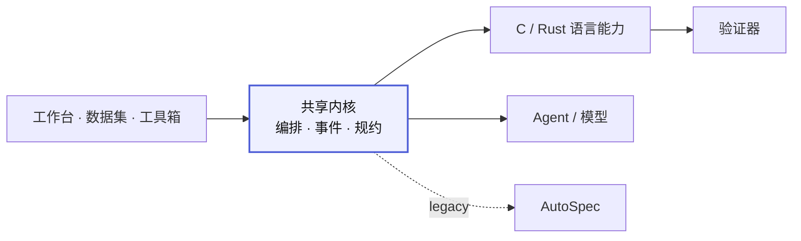

# ACSL AGENT

ACSL AGENT 是一个面向 C 程序的形式化规约自动生成与验证系统。当前提交版聚焦三个主模块：

- `single`：单函数分析
- `termination`：终止性验证
- `inter-modular`：多模块分析
- `spectool`：工具箱，支持函数提取、工程切片、大模型生成 ACSL、`admit` 检查与 Frama-C/WP 验证

## 目录说明

```text
ACSLAgent/
├─ apps/         前端与 FastAPI 接口层
├─ acsl/         分层后端：domain / contracts / application / adapters / infrastructure
├─ configs/      模型与 demo 配置
├─ engine/       规约生成、验证与终止性分析引擎
├─ resources/    演示样例与静态资源
├─ scripts/      启动与辅助脚本
├─ tests/        测试脚本
├─ README.md
├─ requirements.txt
├─ package.json
├─ docker-compose.unified.yml
└─ Dockerfile.unified
```

后端依赖方向：`apps/api`（HTTP）→ `acsl.application`（用例）→ `acsl.domain`；外部能力通过 `acsl.adapters` 接入，`engine/` 只保存语言算法与验证实现。分层规则由 `tests/test_architecture.py` 检查。

## 架构总览

平台采用 **共享运行内核 + 语言能力包** 的结构，C / Rust 共用编排、事件、规约、配置、评测与前端工作台；语言差异收敛到语言能力层。



完整的当前模块、验证路径与重构重点见 [docs/ARCHITECTURE.md](docs/ARCHITECTURE.md)。

## 环境要求

- Python `3.13.x`
- Node.js `18+`
- Docker Desktop

根目录 `.env.example` 给出了环境变量模板。实际运行时需按所选模型平台配置密钥。

## 启动方式

安装依赖：

```powershell
python -m pip install -r requirements.txt
npm install
```

拉取镜像：

```powershell
docker pull junjiehu1905/autospec:latest
docker pull junjiehu1905/termination_analysis:latest
```

启动服务：

```powershell
python scripts/run_api.py
```

C 工作台的“仅验证”会优先使用本机 `frama-c` + `alt-ergo`/`z3`，不需要 AutoSpec 镜像；完整的 AutoSpec 生成流水线仍使用对应镜像。共享验证器的运行时选择见 `.env.example` 中的 `ACSL_VERIFIER_RUNTIME`。

访问地址：

```text
http://127.0.0.1:8000/
```

如需重建前端静态资源：

```powershell
npm run build:web
```

## 功能说明

### single

对单个 C 文件生成 ACSL 函数契约与循环不变式，并执行形式化验证，输出验证状态与相关工件。

### termination

在部分正确性基础上生成 `loop variant`，完成终止性验证，并输出阶段性结果与证明证据。

### inter-modular

对多 `.c/.h` 文件工程执行跨模块分析，合并翻译单元后完成规约生成、验证与结果恢复。

## spectool 集成

`spectool` 的核心逻辑已迁入 `engine/spectool_core/`，并通过现有 FastAPI 服务暴露为 `/api/v1/spectool/*` 接口。前端导航中的“spectool”页面提供独立工具工作台，不影响原有 `single`、`termination` 和 `inter-modular` 任务链。

`spectool` 现在支持直接调用大模型生成 ACSL。页面中选择源码文件、函数和模型后，可通过“AI 生成”或“大模型生成并注入”自动生成函数契约与循环规约，并复用原有注入器生成带 ACSL 的源码。模型列表来自 `configs/models_config.yaml`，密钥按对应平台从 `.env` 中读取，例如 `qwen-turbo` 使用 `aliyun_API_KEY`。

### 服务器部署的模型与网络配置

项目不再默认连接开发电脑的代理、SSH 转发或 Docker Desktop 宿主机地址。复制 `.env.example` 并填写服务器配置：

- `XUANJIAN_AGENT_PROXY` 默认留空，直接访问模型服务；确实需要代理时填写服务器可达的代理地址。
- 微调模型使用对应的 `QWEN35_*_API_BASE_URL`；Docker 服务使用对应的 `QWEN35_*_DOCKER_BASE_URL`，填写容器可达的模型服务地址（以 `/v1` 结尾）。未配置地址的微调模型不能调用。
- 前后端同源部署无需额外跨域配置；分开部署时，在 `ACSL_AGENT_ALLOWED_ORIGINS` 中填写实际前端域名，多个以逗号分隔。
- Codex、Claude Code 的程序和认证，以及验证器，需要在服务器单独安装与配置。

模型选项及模型名保持不变。历史微调服务尚未证实加载 LoRA 权重；模型服务可访问、模型生成的规约通过验证，均不等于已确认微调权重生效。

spectool 的验证器固定使用 Docker 容器，不检测也不调用本机的 `frama-c`、`Alt-Ergo`、`Z3` 或 `veri-clang`。后端会探测现有 `docker-compose.yml` 中的 `autospec`、`termination` 服务，并在容器内执行 Frama-C/WP；上传与输出目录通过仓库挂载映射到容器内 `/app/runtime/spectool/`。可用状态可通过 `GET /api/v1/spectool/capabilities` 查询，其中 `verify_runner` 就绪时固定为 `container`，`container_service` 会显示实际服务名。

环境变量 `SPECTOOL_VERIFY_CONTAINER_SERVICES` 可调整容器探测与执行顺序，默认值为 `autospec,termination`。`SPECTOOL_FRAMAC`、`SPECTOOL_VERI_CLANG` 不参与 spectool 验证器选择。

## 运行产物

任务结果统一写入：

```text
runtime/runs/<task_id>/
```

其中包括：

- `task.json`
- `result.json`
- `artifacts/`

## 说明

- 本提交版源码包仅包含作品主体代码、配置、样例与脚本。
- 外部依赖、运行缓存和历史产物不包含在本目录中。
- 结果判定以系统实际生成的验证工件与 Frama-C/WP 输出为准。


## 历史基准实验结果

项目页提供 LiveFMBench 2025、LiveFMBench 2024 和 autobench 的实验结果入口。导入快照与源码、日志位于 `resources/benchmarks/`，随项目部署，不依赖下载目录。接口为 `/api/v1/benchmarks`、`/api/v1/benchmarks/{id}` 和 `/api/v1/benchmarks/{id}/file?file=...`；前端支持通过 `#/benchmarks/{id}?file=...` 直接定位文件。

汇总采用实验包 scripts 中的修正版报告（违规 admit 按失败计），逐文件目标通过率采用 results.csv。autobench 原始清单为 262 条、报告分母为 257，页面分别显示，保留全部记录；LiveFMBench 2024 为较早的 284 文件版本。历史结果不会自动触发模型调用或重新验证。更新快照可执行 `python scripts/import_benchmark_results.py <实验包目录>`。


### 原始基准源码

基准工作台已附带原始 C 源码，独立保存于 `resources/benchmarks/<id>/original/`，不覆盖实验规约代码或历史分数。可在代码区切换“原始源码 / 实验规约代码”，重跑配置会记录选中的输入版本。重新导入实验结果后，执行 `python scripts/import_benchmark_sources.py <dataset_test目录>` 补充原始源码索引。导入器按唯一文件名匹配，并兼容文件名中的直引号/弯引号差异；不会用近似文件名误配未找到的案例。


### Rust 工作台：Codex 与第三方 API

Rust 项目中选择「Agent API 生成与验证」，再独立选择 Agent、已配置模型与 Skill。Codex 使用平台独立运行时和 Responses API，不读取本机 Codex 登录信息。第三方端点必须实际支持 `/v1/responses`（包括流式响应）；只支持 Chat Completions 的端点可选择模型直连或官方 DeepSeek Harness CLI；Claude Code 则需要 Anthropic Messages 协议。

通过「＋ API 模型」添加多个服务配置；下拉框选择的配置决定实际 Base URL、Model ID、协议与认证方式。使用「编辑当前 API」可以修改当前配置；编辑时 API Key 留空保留原值，明确切换「无需认证」会清除原密钥。Base URL 可填 `/v1`，完整的 `/chat/completions` 或 `/responses` 地址也会规范化为 Base URL。私有配置保存在忽略提交的 `runtime/generation-models.json`。

可将 Responses 配置设为默认模型，新 Rust 任务即默认使用 Codex 和该模型；已有任务保留之前的明确选择。默认英文 Skill 在 `skills/verus/verus-baseline/SKILL.md`，每次生成与修复都会加载其指令，并在运行记录中保存内容快照。RAG 仍需另行配置 embedding；生成结果由实际 Verus 验证器判断是否通过。

Rust 工作台的右侧分为运行、配置、历史三个页签。生成提交后自动切换至运行页；时间线记录准备、生成、Verus 检查及每轮修复的实际起止时间。完成后自动打开结果代码，并展示验证项、错误数、退出码、验证耗时和可展开的诊断。旧记录没有阶段时间时显示「—」，不推算阶段耗时。Skill 使用单选列表，旧内置短提示词不再作为可选 Skill 展示。

NL2VBench 文件浏览器按文件名前缀组织全部任务，VeriCoding 与 VerusBench 包含二级目录。目录接口只返回文件元数据，任务输入接口仅返回自然语言与函数接口。点击任务会打开输入标签；生成结果在独立代码标签自动显示，支持标签切换与关闭。关闭全部标签后显示任务选择引导，也可通过上传 TXT、Markdown、JSON、Rust 文件或新建自定义任务开始。

配置页使用右侧完整可用高度，只有内容实际超出时才滚动。常规模型面板不直接展示 API 地址，地址在编辑配置窗口查看。提交新运行后立即显示本次任务，历史文件的浏览不会替换进行中的进度。生成文件沿用数据集任务名或上传文件名（例如 `VerusBench_Diffy_brs1.verus.rs`），重复输出使用序号区分；原始文件名同时写入运行记录和生成产物。

### Rust Agent 的可迁移安装与部署

Rust/Verus 工作台使用项目管理的官方 Agent 运行时，不依赖开发者的全局 CLI 或个人登录记录：Codex SDK/CLI、Claude Agent SDK 内附的 Claude Code CLI、DeepSeek 官方 `dsh`。依赖版本和完整性由 `configs/agent-runtime/package-lock.json` 与 `configs/deepseek-runtime/package-lock.json` 锁定。可执行文件按部署机器的操作系统和 CPU 架构安装，因此不把一台 Mac 的二进制直接提交为所有服务器的依赖。

同事更新代码后，本机部署执行（需要 Node.js >=24.9 和已安装的 Python 依赖）：

```sh
python scripts/install_agent_runtime.py
python scripts/install_agent_runtime.py --check
```

Docker 使用更新后的统一镜像构建流程，自动安装三套运行时和固定版本 Verus。CLI 位于 `/opt/acsl-agent/agents`，不会被 `./runtime:/app/runtime` 数据卷遮住。镜像构建排除本机 runtime、.env 和 tools/verus，避免复制私人配置、历史任务及错误架构的二进制。默认使用 Linux amd64，因为固定 Verus 发布包没有 Linux arm64 版本。

```sh
docker compose -f docker-compose.unified.yml up -d --build
docker compose -f docker-compose.unified.yml exec acsl-agent python scripts/install_agent_runtime.py --check
```

部署管理员在服务器的 `.env` 配置一次模型服务，网页用户通过后端共享调用，无需自行安装 CLI 或登录厂商账号：

```dotenv
NL2VERUS_MODEL_BASE_URL=http://YOUR_MODEL_SERVER:8888/v1
NL2VERUS_MODEL_ID=deepseek-v4-flash-0731
NL2VERUS_MODEL_NAME=deepseek-v4-flash
NL2VERUS_MODEL_AUTH_MODE=none
NL2VERUS_MODEL_API_KEY=
NL2VERUS_MODEL_PROTOCOLS=chat,responses,anthropic
```

只有服务实际支持的协议才能列入 `NL2VERUS_MODEL_PROTOCOLS`。DeepSeek Harness 走 Chat Completions，Codex 走 Responses，Claude Code 走 Messages；它们使用同一个 Model ID，但不能把接口协议仅靠修改名称混用。服务器必须能访问模型地址，开发机能访问内网服务不代表公网服务器也能访问。需要密钥时将 AUTH_MODE 设为 api_key，在服务器填写密钥，不提交到 Git。

环境变量配置会自动作为部署模型出现，不要求复制个人的 `runtime/generation-models.json`；也可以由管理员在页面配置，存入服务器 runtime 数据卷。该文件不是源码，也不是 CLI。`--check` 只检查依赖，既不代表 API 已连通，也不代表 Verus 已就绪。

官方 Harness 的 Agent 循环由上游 CLI 执行。Claude Code 通过官方 SDK 启动随项目安装的原生 CLI，允许任务目录内的 Read/Write/Edit，以及任务中指定的 Verus Bash 命令；没有改成平台自己调用模型的循环。所有最终输出仍由平台独立 Verus 检查。失败也保存脱敏身份、会话、退出原因和工具事件，不会退回直连 API。输出预算耗尽与网络/API 失败分别报告。

在 Rust 项目中选择 Agent、已配置模型与 Skill 后，可点击「保存为项目默认」。这些选择由项目接口保存，其他浏览器刷新也能加载；保存不会修改源码版本。选中的 Skill 正文作为任务指令上下文传入，当前不声称官方 CLI 的原生 Skill 加载工具已执行。

C/ACSL 与 Rust/Verus 共用上述运行时目录；C 项目仍保留独立的模型与 Skill 设置，原生 Qwen 子模型使用下文的路由配置。多人公网服务的用户认证、队列配额和任务隔离也不由安装脚本提供。

### C 项目：官方 DeepSeek Harness CLI

C 项目验证配置选择「DeepSeek Harness CLI」，并选择已配置的模型和项目 Skill。平台使用与 Rust 工作台相同的官方 `@deepseek-ai/dsh` 固定版本运行时，分层编排与 Sub-agent 派发均由官方 Harness 承载，原来的 Python 自建模型循环已移除。已有项目的 `hierarchical-c` 设置读取时自动迁移为标准 CLI 流程。

运行 `python3 scripts/install_agent_runtime.py` 安装项目隔离运行时，重启后端并刷新网页。CLI 在隔离任务目录中通过真实工具生成候选与调用 Frama-C，平台随后独立检查源码 token、原始断言与 Frama-C 证明结果。运行记录保存官方事件和工具调用证据；执行失败不会回退为直连 API。

C 工作台未保存 Agent 配置时默认选择官方 CLI；其默认模型为部署的 `deepseek-v4-flash-0731`。首次选择时自动绑定 `spec-split`、`spec-orchestrate`、`spec-bottomup` 的固定版本；运行快照包含完整 Skill 内容。官方 CLI 获得平台提供的 `engine.harness_spectool` 工具入口，执行切片、分层、合约填充、注解注入和容器验证。中间目录与官方事件保存在每轮 `agent` 工件内。工具保存合约前重新执行 Frama-C，不信任模型自报的 `--proved`。

### 统一 CLI 目录与原生 Sub-agent

全部运行时集中在 `runtime/cli/`：`deepseek/` 保存官方 Harness，`agents/` 保存隔离 SDK 和配套二进制，`codex/`、`claude/` 可分别放入后续导入的 `codex`、`claude` 可执行文件。统一调用入口是 `python3 runtime/cli/run.py deepseek|codex|claude [参数]`；安装入口仍为 `python3 scripts/install_agent_runtime.py`。

C 工作台以 `deepseek-v4-flash-0731` 为主模型，Sub-agent 下拉框可选 `qwen35-4b-mix64`、`qwen35-9b-mix64`，空值继承主模型。官方 Harness 的原生 `subagent` 工具负责派发和结果回收，项目设置、执行快照和运行时元数据记录所选模型。子 Agent 采用独立上下文和固定路由；选择 Qwen 后不会静默改用 DeepSeek。默认总超时为 200 秒，覆盖主 Agent、子 Agent 和平台验证。

私网 Qwen 服务可复用部署环境的 `XUANJIAN_QWEN_SSH_TARGET`、`XUANJIAN_QWEN_SSH_PORT`：平台只在任务期间建立临时本地转发，结束或超时自动关闭。现有 mix64 部署未开启自动工具调用解析，因此 Qwen 原生子 Agent 使用无工具的规约生成模式，返回文本/JSON；主 DeepSeek Agent 执行注入、WP 验证、合约收集与修复。子任务的官方生命周期 `stop_reason` 被单独记录，未正常结束时不将派发成功视为运行成功。


## VeriFlow 界面迁移分支

`feat/cover-veriflow` 使用 VeriFlow 的页面结构，接入本平台现有 C/Rust 功能，并采用 K 的炭黑、亮青与朱红主题。范围、复用来源、测试方式与环境限制见 [迁移说明](docs/COVER-VERIFLOW.md)。

### C 项目的 Codex / Claude Code API 流程

C 工作台选择 Codex 或 Claude Code 后，可直接使用平台配置的 `deepseek-v4-flash-0731`，无需个人 CLI 登录。Codex 使用 Responses API，Claude Code 使用 Anthropic Messages API；平台按协议规范化 Base URL。三个配套 Skill 的新版支持上述 CLI，切换 Agent 时保留相同指令并绑定适用版本，旧运行快照不变。

两套官方 CLI 都获得仅针对当前输入项目的 Frama-C MCP 工具：`prepare_project` 执行切片与分层，`verify_candidate` 校验候选并执行真实 WP。平台仍在 CLI 结束后独立检查原始源码、断言和证明结果。默认总超时 200 秒，原生工具事件进入实时步骤列表。

实测记录见 [LiveFMBench2024 CLI 接通验证](docs/validation/cli-deepseek-live24-2026-10-30.md)。

### 导入 Claude Code + opus 4.6 + spec-skill 的已有结果

执行 `python scripts/import_opus_benchmarks.py /path/to/ops-4.6`，源目录含 `live25`、`live24`、`autobench` 的 results.jsonl、可选 results.csv/report.md 以及逐文件 `.acsl.c`/`.wp.txt`。导入器只读取数据，不运行源目录代码，不调用模型。

新记录使用 `opus46_live25`、`opus46_live24`、`opus46_autobench` 独立ID，保留原DeepSeek组合。原始C文件通过已导入的对应数据集严格文件名匹配，共享项目内源码副本；不依赖Downloads目录。原始数据集应先完成结果与源码导入，再导入Opus组合。两个组合均可在首页和项目卡片中按名称下方的配置标签辨别。

pass@1/pass@5按有效通过且完成轮次分别为1/不超过5统计，0/0和cheat不计通过。源包live25有1个第6轮通过的文件，其最终状态保留通过，但不计入pass@5。Opus数据集验证窗口预填Claude Code、claude-opus-4-6和适用的spec-bottomup Skill版本；需用户手动提交才会执行新任务。

### DeepSeek Harness 实时基准实验

`XUANJIAN_HARNESS_COMPACT=1 XUANJIAN_PROOF_CONCURRENCY=2 XUANJIAN_PROOF_CPUS=2 python scripts/run_deepseek_benchmarks.py --workers 6 --timeout 600` 使用已配置的
`deepseek-v4-flash-0731` 和固定版本 spec-skill，对 LiveFMBench 2025、2024 与 autobench
的 901 个原始源码文件运行真实实验。三个数据集的待运行文件交错进入共享队列，最多6文件并发生成；本机最多同时执行2个证明容器，每个上限2核。每个文件最多五轮。
先用 `--limit 3 --workers 1` 检查链路。重复启动会恢复未完成案例，进程锁避免重复实验。

结果独立保存在 `resources/benchmarks/dsh_deepseek_*`，包含配置与 Skill 正文快照、源码哈希、
每轮候选、CLI 工具事件、独立 Frama-C 证明日志。首页和数据集页面自动刷新；全部文件结束前
不发布最终通过率。这里的 pass@k 指 k 轮外层 Harness 修复预算，每轮可能包含多次原生模型调用。
三次连续服务异常将停止该批次，待运行文件不计为验证失败；无需改动既有 Claude 组合。

精简C流程通过 `XUANJIAN_HARNESS_COMPACT=1` 启用：直接将完整输入、Skill正文、上轮候选和诊断交给原生文本子Agent，主Agent只保留委派与写入候选工具，避免轮询、重复切片和内部重复证明。平台始终独立检查原始程序/断言保留并执行最终Frama-C证明。超时留下的完整候选经同样的完整性检查后，只能作为未验证草稿供下一轮修复，不会因此计为通过。

`execution-history.json` 与逐轮 `request.json` 记录流程版本变化。恢复既有批次时保留旧结果；混用流程的累计分数不能作为严格的同条件配置对照。

### 项目验证的复杂文件预算

项目工作台默认允许复杂 C 文件自动延长：多个循环、多个 C 文件或源码超过8 KiB时，
将用户填写的总时限提高到至少600秒；更长的手动设置会保留。可取消勾选以严格使用填写的时限。
这是项目任务生成与修复共用的总预算，不是批量实验的逐轮预算。实际预算及触发原因随任务保存，
并为候选返回后的独立证明预留时间。

Codex/Claude 的 Frama-C MCP 使用独立Docker配置，仅携带插件目录与连接设置，不复制注册表凭证。
启动模型前检查Compose可用性；Docker环境错误按不可用处理，避免误记为C语法错误并反复修复。
复杂候选的MCP证明上限90秒，工具通信上限120秒，仍须受项目总预算限制。

### Harness 多轮修复会话

C 项目任务和三数据集批量执行器现在按案例复用一个官方 Harness 进程、主会话和工作区；失败证明诊断作为后续消息进入同一会话，不再每轮启动 CLI。修复请求复用原始上下文，仅追加上一轮候选和诊断。模型及子模型配置在同一案例内固定，Qwen SSH 路由随案例保持，案例退出时统一释放。不同文件的会话隔离；超时终止该进程，下一轮重新建立。

每轮仍保存候选、原生事件与独立证明结果；读取候选前删除旧 answer.json，避免旧候选误用。Skill 正文、原始 C 保留检查与最终独立 Frama-C 检查不变。旧实验结果不重算，暂停的批量实验需手动恢复。运行记录的 session_transport=persistent-jsonl 和 process_reused 标识复用情况。本地假模型已验证官方运行时连续两轮复用同一 PID/session；真实远程模型耗时改善尚需后续测量，进程启动开销减少不代表复杂证明必然通过。

单案例默认最多追加修复 3 轮（首次生成 + 至多 3 次修复）；证明一旦通过立即结束。DeepSeek Harness 后续轮次由原主会话根据已有候选和失败诊断直接修复，不重新委派生成子 Agent。进度分别显示“启动官方 CLI”和“复用原会话修复规约”。生成失败且没有有效候选时停止，不用原始空规约重复生成冒充修复。暂停的历史批量实验及其统计配置保持原样。

### 前端界面语言

右下角语言下拉支持简体中文和 English，默认中文，选择保存在当前浏览器的 `xuanjian.language` 中，页面和 Element Plus 弹窗组件即时切换。中英文文案集中维护于 `apps/web/src/i18n.js` 与 `apps/web/src/locales/en.json`。语言只影响显示，不改变后端数据、项目名称、源码、规约、Skill 正文和验证器原始日志；这些内容保留原文。无需调用翻译服务。

### 原实验 Frama-C 命令对齐

共享 C 验证默认使用 `ACSL_FRAMAC_PROFILE=original`：

```sh
frama-c -wp -wp-precond-weakening -wp-no-callee-precond -wp-prover Alt-Ergo,Z3 -wp-print -wp-timeout 15 file.acsl.c
```

参数顺序与原版 spectool 一致，超时按调用传入（原版工具默认 8 秒，Skill 示例使用 15 秒）；项目最终验证当前单目标上限 15 秒。项目输入路径、头文件搜索路径及终止性任务必要参数另行追加。原实验口径不额外生成 RTE 安全目标，并关闭调用方前置条件目标；它的通过率不能解释为完整运行时安全证明。`strict` 保留 RTE 与调用前置条件检查，结果记录 `verification_profile` 以区分统计口径。Skill 正文、原始 C、原始断言和不允许 admit 绕过的检查不改变。命令参数已对齐，求解器与 Frama-C 版本需另行匹配，不能承诺整个历史数据集逐项一致。

### 百炼 DeepSeek 主模型

主模型新增 `deepseek-v4.1-flash-1017`，使用 OpenAI-compatible Chat Completions API。后端复用私有 `aliyun_API_KEY`，单独设置 `BAILIAN_DEEPSEEK_BASE_URL` 为百炼控制台给出的完整 Base URL（北京地域标准地址为 `https://dashscope.aliyuncs.com/compatible-mode/v1`；如控制台提供专属工作空间地址，可通过该变量覆盖）。准备好后将 `DEEPSEEK_HARNESS_MODEL` 设为该模型 ID 并重新加载后端。未覆盖时使用官方北京标准地址，不回退旧的自部署主模型。

Harness 是本地编排运行时，主模型的推理请求由其通过上述百炼 API 发出；指定的 Qwen 子模型仍使用自己原有的地址和密钥。未指定子模型时仍按界面约定跟随主模型。切换不会改写历史基准实验标签、历史通过率或 Skill 正文。密钥不写入 YAML、前端构建或可公开的模型元数据。

Harness 子任务收尾：子 Agent 完成而 `answer.json` 尚未写入时，在同一主会话中至多追加一次候选落盘提示，不重新生成或启动新子 Agent。持久会话修复轮保留已有候选文件，避免官方工具的文件快照失效；本轮没有更新文件则明确拒绝沿用旧输出。缺少 C 候选时显示正确的 `answer.json` 文件名，并说明验证器尚未执行。

### 人工规约与 Agent 协作

C 项目工作台的“编辑 Agent 规约的人工副本”将候选载入可编辑区，原 Agent 任务工件不变。“保存人工版本”按项目修订号保存不可变 JSON 快照及 `.human.vN.c` 文件（位于 runtime 项目版本目录），历史版本可以单独查看；这些文件不加入项目的编译输入。保存使用修订号冲突检测，避免覆盖其他窗口。

“保存并让 Agent 继续”提交当前人工文件的独立快照，关联本项目、本文件已完成的任务，并带上之前的验证诊断；Agent 在该版本上补充规约，最多追加修复 3 轮。它不直接改写运行中任务的输入，不会按每次键盘输入自动调用收费模型。“仅验证当前规约”只调用本地验证器。人工已存在的断言和约束仍需保留，Agent 不会通过删除人工要求来达成通过。

证明输出的失败目标会生成结构化行号、文件及源码哈希；编辑器用红色行号和底色显示疑似位置，点击诊断跳转。任一求解器已证明的目标不会误标为失败。红色表示未证明或诊断位置，不等于已找到反例；源码编辑后隐藏旧位置，重新验证后更新。

### C 项目的 Sub-agent 选择

项目配置和基准文件重跑均可为 Codex、Claude Code、DeepSeek Harness 选择 `qwen35-4b-mix64` 或 `qwen35-9b-mix64`。DeepSeek Harness 使用原生子 Agent；Codex、Claude Code 使用平台 API 子 Agent 生成并校验候选，再交由主 Agent 检查和验证，主模型须选择平台已配置的 API 模型。两者留空时保留原有执行方式。API 子 Agent 失败时停止并保留诊断，不回退成主模型冒充子模型。后续修复沿用已有候选，不重复调用 API 子 Agent 生成；最终仍执行平台独立 Frama-C 检查。子模型元数据和候选保存在任务对应轮次的 `subagent-runtime.json`、`subagent-candidate.json` 中，不保存密钥。
