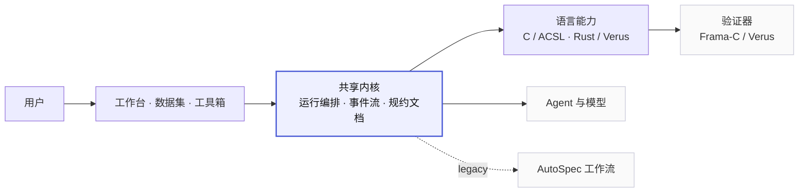
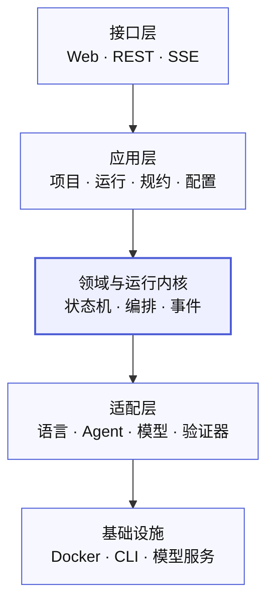

# 架构与模块

> 只记录当前实现和已确认的下一步；不再保留重复的规划文档。
> 最后核对：2026-11-02

## 1. 定位

ACSL Agent 是面向 C / Rust 的可信软件验证平台：输入源码或自然语言需求，由可配置的 Agent + Skill 生成形式化规约（ACSL / Verus），调用验证器（Frama-C/WP、Verus）给出可复现的通过/失败证据。

## 2. 系统全景

三个入口共用一套运行内核；语言差异只在“语言能力”层替换；Agent、模型、验证器作为外部资源接入。



> 事件流、规约文档是已确认的目标；当前实现仍以轮询和源码文本为主，现状见第 4、6 节。

## 3. 分层

自上而下，上层依赖下层；核心不反向依赖外部实现。



- 接口层只做协议转换与展示。
- 应用层编排用例；领域负责契约与端口。
- 语言、Agent、模型、验证器都通过适配层接入，可替换。
- AutoSpec 只作为旧工作流适配，不进入共享内核。

依赖规则（由 `tests/test_architecture.py` 强制执行）：

- `acsl.domain` / `acsl.contracts` 不依赖应用、适配器、HTTP 或 `engine`。
- `acsl.adapters` 不依赖 `acsl.application` 或 HTTP。
- `acsl.application` 不依赖 `apps` 或 FastAPI。
- `engine` 不依赖 `apps`。

## 4. 当前实现模块

### 4.1 分层代码

| 路径 | 职责 |
| --- | --- |
| `apps/api/app/main.py` | FastAPI 装配；健康、模型、文件、spectool、通用任务路由；托管前端 |
| `apps/api/app/workspace.py` | 项目 HTTP 路由；只做请求映射与 `ProjectError → HTTP` |
| `apps/api/app/benchmarks.py`、`skill_library.py`、`rust.py` | 基准、Skill、Rust 的 HTTP 路由 |
| `apps/web/src/views`、`stores`、`api.js` | 工作台、运行/结果页、前端状态与 REST 客户端 |
| `acsl/domain/agents.py` | Agent / Skill / Assistant 配置词汇与校验 |
| `acsl/domain/ports.py` | `RunStore`、`RunOrchestrator`、`AgentRuntime`、`Verifier` 端口 |
| `acsl/contracts/runs.py` | 运行请求、任务、结果的 Pydantic 契约 |
| `acsl/infrastructure/settings.py` | 统一路径、模型目录、阶段标签；测试可重定向 `settings` |
| `acsl/application/projects.py` | 项目持久化、快照、提交、批量、导出；`ProjectService` |
| `acsl/application/runs/manager.py` | `RunManager` 生命周期：提交、执行、物化、概览 |
| `acsl/application/runs/live.py` | replay / single / termination / inter-modular / batch 实际执行 |
| `acsl/application/runs/recovery.py` | 重启恢复、旧回放日志升级 |
| `acsl/application/runs/results.py` | 结果构造与阶段状态转换 |
| `acsl/application/runs/collection.py` | 各模式的工件与日志收集 |
| `acsl/application/runs/metrics.py`、`analysis.py` | 指标解析、调用图、项目级判定与失败分类 |
| `acsl/application/agent_execution.py` | Agent 候选生成、守卫、验证、修复；仅验证 |
| `acsl/application/rust_execution.py` | Rust 生成的校验、文件名与 Verus 执行 |
| `acsl/application/benchmarks.py` | 基准目录读取、重跑历史与提交 |
| `acsl/application/skills.py` | C Skill 版本库与固定引用解析 |
| `acsl/application/demo_cases.py` | demo 案例索引与回放载荷 |
| `acsl/adapters/storage.py` | JSON 运行/上传/工件存储 |
| `acsl/adapters/agent_runtime.py` | Codex / Claude / DeepSeek Harness / 直连调用与状态 |
| `acsl/adapters/github_import.py` | 只读 GitHub 源码导入 |
| `engine/autospec`、`termination`、`spectool_core`、`nl2verus` | 语言算法与生成/验证引擎 |
| `engine/verification/framac_runtime.py` | 共享 C 验证运行时：本机 Frama-C / 专用容器 / legacy |
| `engine/integration/legacy_adapters.py` | 能力探测与 AutoSpec/termination 命令构造 |
| `configs/`、`resources/` | 模型/demo/运行时锁；数据集、基准、Skill、样例 |
| `runtime/` | 项目、运行、Skill、CLI、spectool 运行数据 |
| `scripts/` | 启动、安装 Agent/Verus、构建前端、导入基准 |

### 4.2 兼容层

`apps/api/app/service.py`、`agent_execution.py`、`agent_runners.py`、`storage.py`、`config.py`、`schemas.py`、`assistants.py`、`demo_cases.py`、`project_import.py` 现在只是 re-export shim，保证旧导入与已有测试仍可用；新代码应直接引用 `acsl.*`。后续可在确认无外部调用后删除。

## 5. 验证与 Agent 路径

| 场景 | 入口 | 当前运行时 |
| --- | --- | --- |
| C 仅验证已有 ACSL | 工作台「仅验证」→ `verification_only=true` | `framac_runtime`：本机 Frama-C 优先 |
| C Agent 候选验证 | `execute_agent` → `verify_candidates` | 同上 |
| C spectool 验证 | `/api/v1/spectool/verify` | `spectool_adapter._run_wp`：本机优先 |
| C AutoSpec 单函数/多模块 | `single` / `inter-modular` | `autospec` 镜像（legacy） |
| C 终止性 | `termination` | termination / autospec 镜像 |
| Rust 生成/验证 | `rust-generate` / `rust-verify` | 原生 Verus |
| Agent | DeepSeek Harness / Claude Code / Codex / 直连 | `runtime/cli` 项目隔离运行时 |

验证器运行时由以下环境变量控制：

| 变量 | 作用 |
| --- | --- |
| `ACSL_VERIFIER_RUNTIME` | `auto`（默认，本机优先）/ `host` / `container` / `legacy` |
| `ACSL_VERIFIER_SERVICE` | 专用验证容器服务名，默认 `verifier` |
| `SPECTOOL_VERIFY_RUNNER` | spectool 单独覆盖：`auto` / `host` / `container` |
| `SPECTOOL_FRAMAC` | 指定本机 Frama-C 可执行文件 |

约束：

- **AutoSpec 镜像只服务 AutoSpec 完整流水线**；共享验证不隐式依赖它。
- 本机 Frama-C 与容器验证的结果都记录 `runner`、`runtime`；不要静默混用版本。
- 本机 Frama-C 已验证可用（当前 `27.1` + Alt-Ergo/Z3）。

## 6. 已确认、尚未实现

| 项 | 当前状态 |
| --- | --- |
| 事件日志 + SSE + 终端 | 未实现；当前前端 1–3 秒轮询 |
| 规约文档、检查点、实时修改后续跑 | 未实现；当前只有 spectool 表单可改规约 |
| 中英文切换 | 未实现；文案硬编码 |
| 分层包 `acsl/` | 已完成：domain / contracts / application / adapters / infrastructure |
| `RunManager` 单文件拆分 | 已完成：manager / live / recovery / results / collection / metrics / analysis |
| 项目、基准、Rust 用例出路由 | 已完成：`ProjectService`、`BenchmarkRunService`、`rust_execution` |
| `engine → apps.api` 反向依赖 | 已消除；由架构测试守护 |
| 单一编排器 | 未完成；`RunManager` 与 `WorkflowRuns` 仍并行 |
| 专用验证容器 | 未实现；本机 Frama-C 已验证，服务器需补镜像 |
| 统一 Agent/Model/Skill 注册表 | 未完成；当前多来源 |
| 前端统一工作台外壳、时间线 | 未实现；C/Rust 工作台各自维护 |
| 人审默认策略 | 已定：工作台 `on_failure`，基准 `never`，单次可勾选“注入前暂停审阅” |

## 7. 下一步重构重点

1. 合并两套编排器：`RunManager` 与 `WorkflowRuns`，统一状态、取消、超时、恢复。
2. 用 `acsl.domain.ports` 收口应用层对具体适配器的直接导入，改为组合根注入。
3. 统一 Agent 调用：Codex/Claude 当前有一次性 CLI 与 SDK/工具两条路径。
4. 继续收敛 Frama-C：Agent 候选、spectool、仅验证已走共享运行时；AutoSpec/termination 内部仍是独立实现。
5. 统一 Model/Agent/Skill 配置与状态词汇。
6. 前端抽出统一工作台外壳、运行时间线、轮询/事件订阅。
7. 中英文切换：后端消息 key + 前端词典。
8. 事件日志 + SSE 与规约文档/检查点。

不需要重构：AutoSpec 内部算法、Verus 验证器内部、NL2Verus 检索与提示词算法。

## 8. 验证

```sh
.venv/bin/python -m pytest -q
```

`tests/test_architecture.py` 检查分层依赖与模块归属；`tests/test_application_services.py` 直接测试无 HTTP 依赖的应用服务。

## 9. 文档

- [README](../README.md)：安装、启动、功能入口。
- [CONTRIBUTING](../CONTRIBUTING.md)：本地开发与检查。
- [RUST-WORKFLOW](RUST-WORKFLOW.md)：Rust/Verus 的两种模式与边界。
- [verus-generation](verus-generation.md)：Rust 生成 Agent、模型、Skill 与运行记录。
