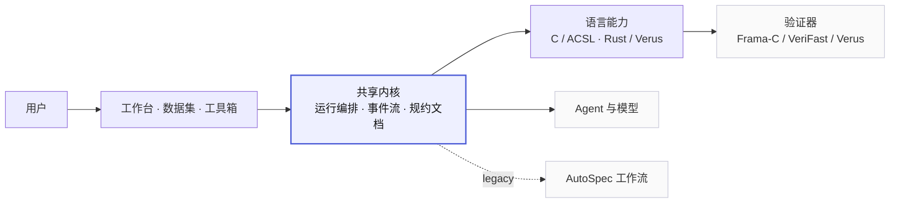
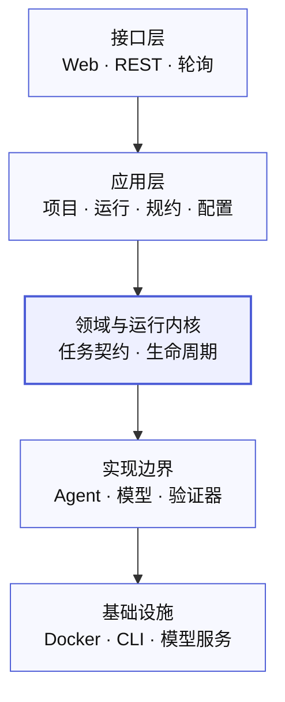
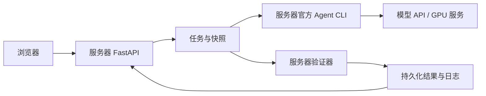

# 架构与模块

> 只记录当前实现和已确认的下一步；不再保留重复的规划文档。
> 最后核对：2026-11-05

## 1. 定位

ACSL Agent 是面向 C / Rust 的可信软件验证平台：输入源码或自然语言需求，由可配置的 Agent + Skill 生成形式化规约（ACSL / VeriFast / Verus），调用验证器（Frama-C/WP、VeriFast、Verus）给出可复现的通过/失败证据。

## 2. 系统全景

三个入口共用一套运行内核；语言差异只在“语言能力”层替换；Agent、模型、验证器作为外部资源接入。



> 当前通过轮询展示原生 Agent 命令、工具输出及任务进度；人工规约以版本快照保存。不将 SSE 或独立规约文档引擎描述为已实现。

## 3. 分层

自上而下，上层依赖下层；核心不反向依赖外部实现。



- 接口层只做协议转换与展示。
- 应用层编排用例；领域负责契约与端口。
- 语言、Agent、模型、验证器都通过适配层接入，可替换。
- AutoSpec 只作为旧工作流适配，不进入共享内核。

依赖规则（由 `tests/test_architecture.py` 强制执行）：

- `acsl.domain` / `acsl.contracts` 不依赖应用、适配器、HTTP 或 `engine`。
- `acsl.adapters` 不依赖 `acsl.application` 或 HTTP。
- `acsl.application` 不依赖 `apps` 或 FastAPI。
- `engine` 不依赖 `apps`。

## 4. 当前实现模块

### 4.1 分层代码

| 路径 | 职责 |
| --- | --- |
| `apps/api/app/main.py` | FastAPI 装配；健康、模型、文件、spectool、通用任务路由；托管前端 |
| `apps/api/app/workspace.py` | 项目 HTTP 路由；只做请求映射与 `ProjectError → HTTP` |
| `apps/api/app/benchmarks.py`、`skill_library.py`、`rust.py` | 基准、Skill、Rust 的 HTTP 路由 |
| `apps/web/src/views`、`stores`、`api.js` | 工作台、运行/结果页、前端状态与 REST 客户端 |
| `acsl/domain/agents.py` | Agent / Skill / Assistant 配置词汇与校验 |
| `acsl/domain/ports.py` | `RunStore`、`RunOrchestrator`、`AgentRuntime`、`Verifier` 端口 |
| `acsl/contracts/runs.py` | 运行请求、任务、结果的 Pydantic 契约 |
| `acsl/infrastructure/settings.py` | 统一路径、模型目录、阶段标签；测试可重定向 `settings` |
| `acsl/application/projects.py` | 项目持久化、快照、提交、批量、导出；`ProjectService` |
| `acsl/application/runs/manager.py` | `RunManager` 生命周期：提交、执行、物化、概览 |
| `acsl/application/runs/live.py` | replay / single / termination / inter-modular / batch 实际执行 |
| `acsl/application/runs/recovery.py` | 重启恢复、旧回放日志升级 |
| `acsl/application/runs/results.py` | 结果构造与阶段状态转换 |
| `acsl/application/runs/collection.py` | 各模式的工件与日志收集 |
| `acsl/application/runs/metrics.py`、`analysis.py` | 指标解析、调用图、项目级判定与失败分类 |
| `acsl/application/agent_execution.py` | Agent 候选生成、守卫、验证、修复；仅验证 |
| `acsl/application/rust_execution.py` | Rust 生成的校验、文件名与 Verus 执行 |
| `acsl/application/benchmarks.py` | 基准目录读取、重跑历史与提交 |
| `acsl/application/skills.py` | C Skill 版本库与固定引用解析 |
| `acsl/application/demo_cases.py` | demo 案例索引与回放载荷 |
| `acsl/adapters/storage.py` | JSON 运行/上传/工件存储 |
| `acsl/adapters/agent_runtime.py` | Codex / Claude / DeepSeek Harness / 直连调用与状态 |
| `acsl/adapters/github_import.py` | 只读 GitHub 源码导入 |
| `engine/autospec`、`termination`、`spectool_core`、`nl2verus` | 语言算法与生成/验证引擎 |
| `engine/verification/report.py`、`acsl/contracts/verification.py` | 公共验证报告与诊断，保留工具原生指标 |
| `acsl/infrastructure/task_control.py` | 外层与嵌套任务共用预算和取消边界 |
| `engine/verification/verifast_runtime.py` | VeriFast 编译单元验证、源码快照与原始证据 |
| `engine/verification/framac_runtime.py` | 共享 C 验证运行时：默认服务器本机调用，旧容器模式仅兼容 |
| `engine/integration/legacy_adapters.py` | 能力探测与 AutoSpec/termination 命令构造 |
| `configs/`、`resources/` | 模型/demo/运行时锁；数据集、基准、Skill、样例 |
| `runtime/` | 项目、运行、Skill、CLI、spectool 运行数据 |
| `scripts/` | 启动、安装 Agent/Verus、构建前端、导入基准 |

### 4.2 兼容层

`apps/api/app/service.py`、`agent_execution.py`、`agent_runners.py`、`storage.py`、`config.py`、`schemas.py`、`assistants.py`、`demo_cases.py`、`project_import.py` 现在只是 re-export shim，保证旧导入与已有测试仍可用；新代码应直接引用 `acsl.*`。后续可在确认无外部调用后删除。

## 5. 验证与 Agent 路径

| 场景 | 入口 | 当前运行时 |
| --- | --- | --- |
| C VeriFast 生成/直接验证 | 相同任务入口、独立工具适配器 | 服务器本机 |
| C 仅验证已有 ACSL | 工作台「仅验证」→ `verification_only=true` | `framac_runtime`：服务器本机 Frama-C |
| C Agent 候选验证 | `execute_agent` → `verify_candidates` | 同上 |
| C spectool 验证 | `/api/v1/spectool/verify` | `spectool_adapter._run_wp`：本机优先 |
| C AutoSpec 单函数/多模块 | `single` / `inter-modular` | 本机旧工具链（需要 veri-clang） |
| C 终止性 | `termination` | 服务器本机 Frama-C 与 gcc（旧流程） |
| Rust 生成/验证 | `rust-generate` / `rust-verify` | 原生 Verus |
| Agent | DeepSeek Harness / Claude Code / Codex / 直连 | `runtime/cli` 项目隔离运行时 |

验证器运行时由以下环境变量控制：

| 变量 | 作用 |
| --- | --- |
| `ACSL_VERIFIER_RUNTIME` | `host`（默认）；其他值仅兼容旧配置 |
| `ACSL_VERIFIER_SERVICE` | 专用验证容器服务名，默认 `verifier` |
| `SPECTOOL_VERIFY_RUNNER` | spectool 默认 `host`，不自动探测容器 |
| `SPECTOOL_FRAMAC` | 指定本机 Frama-C 可执行文件 |

约束：

- 共享验证默认直接调用服务器本机工具；旧 AutoSpec 流水线保留自身依赖，不将其容器作为默认验证后端。
- 验证器版本由实际服务器安装决定；开发机验证通过不等于服务器部署已验收。

## 6. 当前状态与重构范围

| 能力 | 状态与边界 |
| --- | --- |
| 中英文切换 | 已实现；不翻译源码和验证器原始日志 |
| Agent 终端 | 已实现命令、工具输出和补充指令；轮询读取，非浏览器任意 Shell |
| 人工规约 | 已实现源码锁定、版本去重、对比、独立快照和继续修复 |
| 验证工具 | Frama-C / WP、VeriFast、Verus；保留各自原生指标 |
| CLI 修复会话 | DeepSeek Harness 在单案例内复用，最多追加 3 轮修复 |
| 统一内核 | 共用任务外壳，Rust 内部保留自己的生成工作流 |
| SSE | 暂不引入；现有轮询可满足当前规模 |

## 7. 实施顺序与验收标准

1. **更新文档**：区分已实现、保留的兼容路径和未实现能力，不将规划描述为现状。
2. **统一验证结果与诊断**：新增版本化公共结果，包含工具、结论、原生指标、源文件哈希、结构化诊断及命令。保留旧字段以兼容历史任务。不得把 VeriFast 语句数转换为 Frama-C proof goals，不从失败推算分母。
3. **统一任务生命周期**：共用排队、运行、终态映射、任务总预算和取消边界。Rust 子工作流受外层任务控制，但不重写其生成算法。停止后不得继续生成或验证；已经发出的调用可能到返回或自身超时才结束，不能声称即时撤销远程请求。
4. **按实际重复抽组件**：优先共享验证结果展示与诊断区域，保留 C/Rust 特有的输入与交互。避免用一个巨大组件替代两套页面。

暂不全量合并执行器、不引入新的注册表体系、不重写 Skill 和验证器算法。端口只在需要替换或测试的边界逐步使用。现有 Mixin 拆文件有助于阅读，但不视为已经完成职责解耦。

### 7.1 服务器部署是最终运行形态

浏览器通过 HTTP 访问服务器，服务器运行 FastAPI、官方 Agent CLI、Frama-C / WP、VeriFast 和 Verus。浏览器不安装 CLI 或验证器，也不接收模型密钥。模型服务可由服务器访问外部 API 或单独的 GPU 推理服务。



- 可执行文件直接安装在服务器操作系统，按服务器架构下载，不复制开发机的 macOS 二进制，不采用 Docker 验证器。
- 官方 CLI、Frama-C、VeriFast 和 Verus 由服务器后端直接调用；服务账号必须具备 PATH、读取和执行权限。
- 按启动 profile 区分：`local` 将 Frama-C、VeriFast 路由至本机 Docker；`server` 将其固定为服务器原生调用，缺少工具时不回退 Docker。业务流程和结果契约共用。
- `.env` 与模型鉴权只在服务器维护；`runtime/` 持久化项目、任务、人工版本和日志。模型地址由服务器实际访问，不依赖浏览器所在电脑的网络。
- 当前 JSON 存储与任务执行按单 API worker 部署。多进程/多节点队列、用户认证和配额不是现有架构已提供的能力。
- 重启后保留已有工件，不自动重发模型请求；中断任务明确标记，恢复需用户提交新任务。

部署步骤与检查命令见 [SERVER-DEPLOYMENT.md](SERVER-DEPLOYMENT.md)。

### 7.2 公共数据与兼容策略

- 新运行结果的 `verification` 为版本 1 报告：`tool`、`outcome`、`verified`、`metric`、`diagnostics`、`source_hashes`、`command`、`elapsed_ms`、`exit_code`。
- 指标单位分别为 `proof-goals`、`verified-statements`、`verification-items`；VeriFast 的原生总量未知时保持 `null`。成功时前端 N/N 是展示约定，不伪造原生目标总数。
- 原生适配器通过 `report` 提供公共字段，同时保留原字段；历史记录不批量改写，前端保留旧结构回退。
- 诊断只有能唯一关联输入源码时才带可跳转行号；保留来源确定性与源文件哈希，不能把工具失败解释为程序反例。
- 公共任务终态增加 `cancelled` / `Cancelled`。`POST /api/v1/runs/{task_id}/cancel` 请求协作式停止；终态后重复请求不重新运行。
- 嵌套 Rust 任务继承外层控制上下文；剩余预算限制后续验证与支持超时的 Agent 调用。取消/超时后保留已返回候选和工作流快照。
- `VerificationMetric`、`VerificationDiagnostics` 与 `RunControls` 供多个页面复用，不统一各语言特有的编辑和生成表单。

## 8. 验证

```sh
.venv/bin/python -m pytest -q
```

`tests/test_architecture.py` 检查分层依赖与模块归属；`tests/test_application_services.py` 直接测试无 HTTP 依赖的应用服务。

## 9. 文档

- [README](../README.md)：安装、启动、功能入口。
- [CONTRIBUTING](../CONTRIBUTING.md)：本地开发与检查。
- [RUST-WORKFLOW](RUST-WORKFLOW.md)：Rust/Verus 的两种模式与边界。
- [verus-generation](verus-generation.md)：Rust 生成 Agent、模型、Skill 与运行记录。
